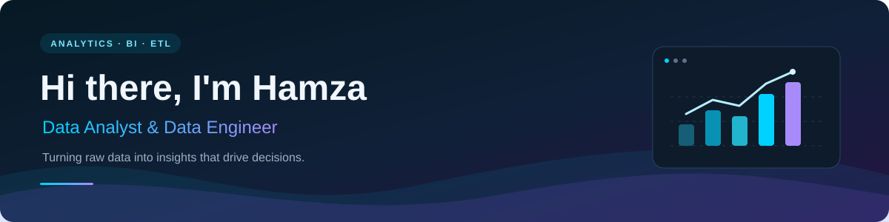

<div align="center">




<p>
<a href="https://www.linkedin.com/in/hamza-imran-ghani-8a99a3345/"></a>

<a href="https://github.com/HamzaImran356"></a>
</p>

<p><b>Reliable data pipelines. Clear dashboards. Better decisions.</b></p>

</div>

---

### ⚡ About Me

I'm **Hamza Imran Ghani**, a **Data Analyst and Data Engineer** based in Lahore, Pakistan. I work across data preparation, warehousing, business intelligence, and machine learning to turn raw data into useful insights.

```yaml
name: Hamza Imran Ghani
current_role: Data Engineer at Abacus
education: BS Computer Science, FAST NUCES Lahore (2022–2026)
focus: [Data Analytics, Business Intelligence, ETL, Data Warehousing]
tools: [SQL, Power BI, Power Query, DAX, Talend, Python]
interests: [Reliable Data Pipelines, Dashboard Design, Applied Machine Learning]
```

- 🔭 **Currently:** Data Engineer at **Abacus**.
- 📊 **Previously:** Data analytics internships at **Systems Limited** and **TenX Private Limited**.
- 🛠️ **What I build:** ETL pipelines, dimensional data models, interactive dashboards, and applied ML projects.
- 💬 **Ask me about:** SQL, Power BI, DAX, Power Query, Talend, star schemas, and SCD Type-2.
- 🤝 **Let's connect:** I'm interested in analytics, BI, and data engineering collaborations.

---

### 🛠️ Tech Stack & Capabilities

<div align="center">

#### 📊 Analytics & Business Intelligence

<p>
  
  
  
  
  
</p>

#### ⚙️ Data Engineering & Warehousing

<p>
  
  
  
  
  
</p>

#### 🐍 Programming & Data Analysis

<p>
  
  
  
  
  
</p>

#### 🤖 Machine Learning & Computer Vision

<p>
  
  
  
  
  
</p>

</div>

---

### 💼 Experience & Impact

| Role | Organization | Period |
| :--- | :--- | :--- |
| **Data Engineer** | Abacus | Oct 2026 – Present |
| **Data Analytics Intern** | Systems Limited | Jun 2025 – Aug 2025 |
| **Data Analytics Intern** | TenX Private Limited | Jun 2024 – Aug 2024 |

<table>
<tr>
<td align="center" width="33%"><h3>40%</h3><p>Fewer null and duplicate records through Power Query transformations.</p></td>
<td align="center" width="33%"><h3>35%</h3><p>Lower average query execution time using a star-schema data model.</p></td>
<td align="center" width="33%"><h3>&lt; 30 min</h3><p>Daily data preparation time, reduced from 3 hours with Talend ETL pipelines.</p></td>
</tr>
</table>

- **Systems Limited:** Built three Power BI dashboards covering 10+ business KPIs; transformed five source tables and modelled six or more fact and dimension tables.
- **TenX:** Integrated four data sources into a central warehouse, implemented SCD Type-2 to preserve customer history, and delivered two Power BI dashboards for stakeholder reviews.

---

### 🚀 Featured Projects

<table>
<tr><td>
<h3>📊 Adventure Works — End-to-End Analytics</h3>
<p>An analytics project connecting <b>Talend ETL</b>, an <b>SCD Type-2 warehouse</b>, and a <b>Power BI dashboard</b> to explore sales performance, customer activity, orders, and regional trends.</p>
<ul>
<li>Interactive KPIs, slicers, drill-downs, and product/category views.</li>
<li>Dimensional modelling and historical customer records for consistent analysis.</li>
<li>Revenue, orders, customer behaviour, and sales territory reporting using the Adventure Works dataset.</li>
</ul>
<p><b>Tools:</b> Power BI · Talend · SQL · DAX</p>
</td></tr>
</table>

<table>
<tr><td>
<h3>🎙️ DeepTrace — Deepfake Detection</h3>
<p>Final Year Project at FAST NUCES, combining <b>Random Forest models on MFCC features</b> with <b>CNN models on spectrograms</b> for deepfake audio detection.</p>
<ul>
<li>Built preprocessing pipelines and codec-simulation augmentation for realistic audio conditions.</li>
<li>Evaluated robustness across datasets and worked on reducing false negatives on unseen audio.</li>
<li>Contributed to an end-to-end audio and video deepfake detection platform with the project team.</li>
</ul>
<p><b>Tools:</b> Python · CNN · Random Forest · MFCC</p>
<p><a href="https://github.com/HamzaImran356/DeepTrace"><b>View DeepTrace fork →</b></a> · Private collaborative project; access required.</p>
</td></tr>
</table>

<table>
<tr>
<td width="50%" valign="top">
<h4>🧠 Brain Tumor Detection</h4>
<p>A four-class MRI tumour classification project using a custom CNN in PyTorch, with <b>92% reported validation accuracy</b>.</p>
<p><b>Tools:</b> Python · PyTorch · CNN</p>
</td>
<td width="50%" valign="top">
<h4>🙂 Facial Emotion Recognition</h4>
<p>A seven-class emotion recognition system using CNN and OpenCV, running at <b>20+ FPS</b> on live webcam input with <b>84% reported FER-2013 accuracy</b>.</p>
<p><b>Tools:</b> Python · OpenCV · CNN</p>
</td>
</tr>
</table>

<p align="center"><a href="https://www.linkedin.com/in/hamza-imran-ghani-8a99a3345/">More about my projects and experience →</a></p>

---

### 🎓 Education & Certifications

**BS Computer Science · FAST NUCES, Lahore · 2022–2026**

Relevant coursework: Data Structures & Algorithms, Artificial Intelligence, Database Systems, and Operating Systems.

<p>
<a href="https://www.coursera.org/account/accomplishments/professional-cert/8W5OA8VI8YKM"></a>
<a href="https://www.coursera.org/account/accomplishments/specialization/8KJNRH8KEGZR"></a>
</p>

---

### 📊 GitHub Statistics & Activity

<div align="center">


<p>


</p>


</div>

---

### 📫 Connect With Me

<div align="center">

<p>Let's talk about analytics, BI dashboards, data pipelines, and applied machine learning.</p>

<a href="https://www.linkedin.com/in/hamza-imran-ghani-8a99a3345/"></a>
<a href="https://github.com/HamzaImran356"></a>
<a href="mailto:imranhamza136@gmail.com"></a>

<br /><br />


</div>
